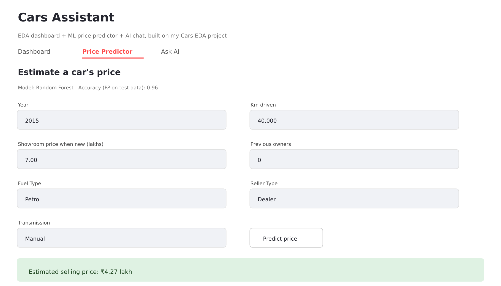

# 🚗 Cars Assistant

An AI-powered web app that extends my **Cars EDA project** with an ML price predictor and a Gemini-powered Q&A assistant.

> Built for **Module 05: AI Tools & Mini Project**.

## ✨ Features
- 📊 **Interactive EDA dashboard** with year and fuel filters (distribution, price by fuel, price vs km, correlation heatmap)
- 💰 **Price predictor** using a Random Forest regression model
- 🤖 **Ask AI**: ask questions about the dataset in plain English using the Google Gemini API

## 🛠 Tech Stack
Python · Pandas · Plotly · Scikit-learn · Streamlit · Google Gemini API

## 📸 Screenshots
| Dashboard | Price Predictor |
|---|---|
|  |  |

## 🚀 How to Run
```bash
git clone https://github.com/<your-username>/cars-assistant.git
cd cars-assistant
pip install -r requirements.txt

# Windows PowerShell
$env:GEMINI_API_KEY="your_key"
# Mac/Linux
# export GEMINI_API_KEY="your_key"

streamlit run app.py
```
Get a free API key at [Google AI Studio](https://aistudio.google.com). You can also paste the key in the app's sidebar. **Never commit your key.**

## 📂 Dataset
`data/cars.csv`: 301 used cars with columns Car_Name, Year, Selling_Price, Present_Price, Kms_Driven, Fuel_Type, Seller_Type, Transmission, Owner (prices are in lakhs of rupees). Column names are configured at the top of `app.py`.

> **Note on accuracy:** the model scores about 0.96 R² on the default test split, but the score varies with the split (roughly 0.5 to 0.96) because the dataset is small (301 rows) and has a few very expensive outlier cars.

## 🔍 AI Tools Exploration
I gave the same coding prompt to three AI tools and compared them.

| Tool | Code quality | Explanation clarity | Speed | Best used for |
|---|---|---|---|---|
| ChatGPT | _fill in_ | _fill in_ | _fill in_ | _fill in_ |
| Gemini | _fill in_ | _fill in_ | _fill in_ | _fill in_ |
| Copilot | _fill in_ | _fill in_ | _fill in_ | _fill in_ |

**How AI tools help**
- **Coding:** _fill in 2-3 lines_
- **Research:** _fill in 2-3 lines_
- **Productivity:** _fill in 2-3 lines_

## 💡 What I Learned
- How to call an AI API from Python and use it inside an app
- Turning EDA work into an interactive Streamlit dashboard
- Training and using a simple regression model
- AI tools are great pair-programmers, but I still need to understand and test the code

## 🔗 Links
- Original EDA project (Colab): https://colab.research.google.com/drive/1ydsQT52mH1BNA-KkTPddwuc9EhzH1U0N?usp=sharing
- Live demo: _add your Streamlit link if deployed_

## 👤 Author
**Rudraksh Sivam K U** · 25IT301
