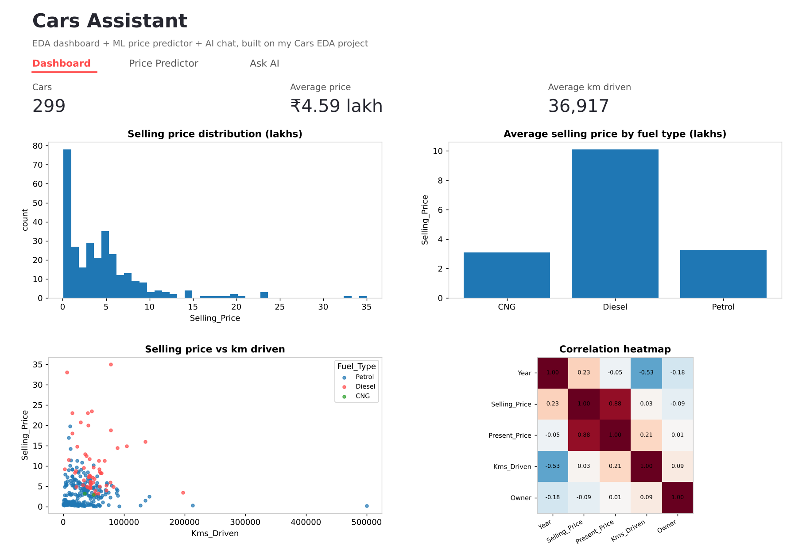

# 🚗 Cars Assistant

A Streamlit web app that extends my **Cars EDA project** with an interactive dashboard, a machine learning price predictor and an optional AI question-answering tab.

> Built for **Module 05: AI Tools & Mini Project**

---

## ✨ Features

- 📊 **Interactive EDA dashboard**: filter by year and fuel type and explore the price distribution, average price by fuel type, price vs km driven and a correlation heatmap
- 💰 **Price predictor**: a Random Forest model estimates a used car's selling price from its year, km driven, showroom price, number of owners, fuel type, seller type and transmission
- 🤖 **Ask AI (optional)**: ask questions about the dataset in plain English using the Google Gemini API. This tab needs your own free API key; the rest of the app works without it

## 🛠 Tech Stack

Python · Pandas · Plotly · Scikit-learn · Streamlit · Google Gemini API

## 📸 Screenshots

| Dashboard | Price Predictor |
|---|---|
|  |  |

## 🚀 How to Run

1. Download or clone this repository:
   ```bash
   git clone https://github.com/rudrakshsivam/cars-assistant-without-api-key.git
   cd cars-assistant-without-api-key
   ```
2. Install the requirements:
   ```bash
   python -m pip install -r requirements.txt
   ```
3. Start the app:
   ```bash
   python -m streamlit run app.py
   ```
4. *(Optional)* To use the **Ask AI** tab, get a free key from [Google AI Studio](https://aistudio.google.com) and paste it into the sidebar box in the app. Never upload your key to GitHub.

## 📂 Dataset

`data/cars.csv` contains 301 used cars with these columns:

| Column | Meaning |
|---|---|
| Car_Name | Car model |
| Year | Year of purchase |
| Selling_Price | Price the car sold for (in lakhs of rupees) |
| Present_Price | Showroom price of the car when new (in lakhs) |
| Kms_Driven | Kilometres driven |
| Fuel_Type | Petrol, Diesel or CNG |
| Seller_Type | Dealer or Individual |
| Transmission | Manual or Automatic |
| Owner | Number of previous owners |

## 📊 Model Results

- Model: Random Forest Regressor (200 trees)
- Train/test split: 80% / 20%
- Accuracy on the test set: **R² ≈ 0.96**

> The score changes with the split (roughly 0.5 to 0.96) because the dataset is small and a few very expensive cars act as outliers.

## 🔍 AI Tools Exploration

For this module I explored popular AI tools and how they support a project like this.

| Tool | Where it helps most |
|---|---|
| **ChatGPT** | Explaining code step by step and debugging errors |
| **Gemini** | Quick answers, data questions and the API used in this app's Ask AI tab |
| **Microsoft Copilot** | Code suggestions and quick help while writing |

**How AI tools help**
- **Coding:** they generate starter code, explain errors and suggest fixes, which speeds up building and debugging.
- **Research:** they summarise concepts such as Random Forest and evaluation metrics quickly, though the answers still need checking.
- **Productivity:** they help draft documentation, README files and project posts, saving time on writing.

## 💡 What I Learned

- Turning EDA work into an interactive Streamlit dashboard
- Training and testing a regression model with Scikit-learn
- How to connect an AI API to an app
- AI tools are great helpers, but I still need to understand and test the code myself

## 🔗 Links

- Original EDA project (Colab): https://colab.research.google.com/drive/1ydsQT52mH1BNA-KkTPddwuc9EhzH1U0N?usp=sharing

## 👤 Author

**Rudraksh Sivam K U** · 
